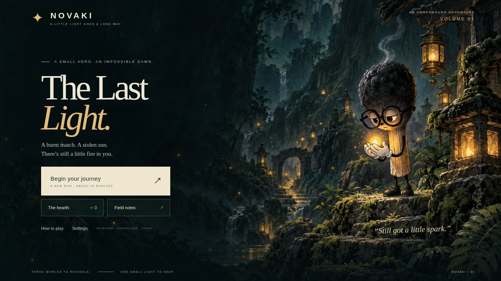
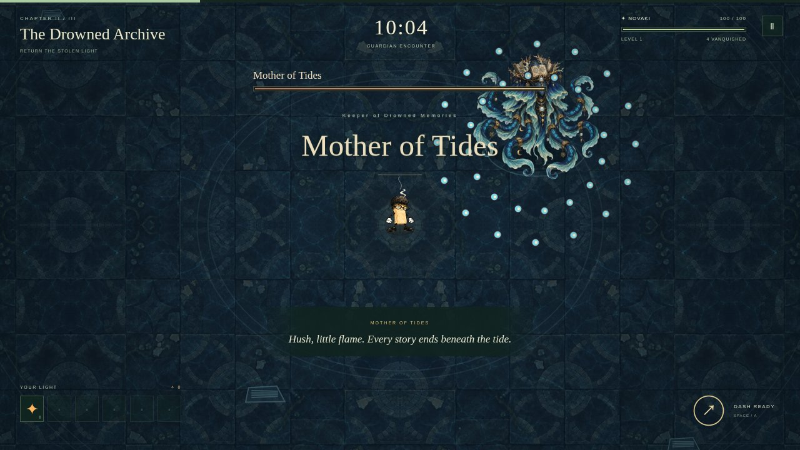

# Novaki: The Last Light

**A burnt match. A stolen sun. There is still a little fire in you.**

A complete top-down action roguelite for the browser, built from a single prompt by **GPT-6 Astra** (Codex, ultra effort) with no human help. It is one of four games from Novaki's test 06: four AI coding agents got the exact same brief, and each built its own game alone.

Video: coming soon on the [Novaki YouTube channel](https://www.youtube.com/@Novaki_ai).




*Screenshots taken by the automated tests.*

## Result

| | |
|---|---|
| Made by | GPT-6 Astra in Codex, ultra effort |
| Prompt | one message: [PROMPT.md](PROMPT.md), identical for all four agents |
| Human help | none: no fixes, no hints, no follow-up messages |
| Time | 32 min (the agent said it was done) |
| Cost | $32.99 at API prices (model $32.66, voice and music $0.33) |
| Assets generated | 24 images, 12 voice lines, 8 music clips |
| Hidden tests | 92.8 / 100 |
| **Blind judges' average** | **7.47 / 10** |
| Git history | 13 commits by the agent (untouched) + 1 publishing commit |

Astra said it was done after 32 min.

## The four games

| Game | Made by | Judges' average (/10) | Hidden tests (/100) | Time | Cost (API prices) |
|---|---|---|---|---|---|
| [Strike Twice](https://github.com/novaki-ai/strike-twice) | Claude Opus 5.5 (Claude Code, max) | 9.03 | 100 | 5 h 38 min | $154.35 |
| **The Last Light** (this repo) | **GPT-6 Astra (Codex, ultra)** | **7.47** | **92.8** | **32 min** | **$32.99** |
| [Still Smoldering](https://github.com/novaki-ai/still-smoldering) | Gemini 4 Argon (Antigravity, high) | 6.72 | 99 | 1 h 30 min | $3.68 |
| [Last Spark](https://github.com/novaki-ai/last-spark) | Kimi K3 (Kimi Code, max) | 5.25 | 82.5 | 2 h 19 min | $17.58 |

## How the test worked

- **One brief, one message.** Each agent got [PROMPT.md](PROMPT.md) and then worked alone in its own folder with the same tools, for up to 8 hours. Nobody fixed, hinted or reviewed anything during the runs.
- **Same asset tools for everyone.** Every image was generated with a GPT image model (through Codex), every voice line with Gemini text-to-speech (`gemini-3.8-flash-lite-tts`) and every music clip with Lyria (`lyria-3-clip`), all through a small `varlik` command that was part of the test setup (it is not included here). Sound effects, UI and visual effects are made in code.
- **Clean setup.** The agents saw no personal instructions, custom skills or extra MCP servers.
- **Blind judges (the main score).** The four competing agents themselves, with the same model and effort, judged all four games. Each judge saw the games only as letters A to D, in a different order per judge, with traces of who made them masked. They played the games, read the source and the submission notes, saw the hidden-test results and gave an overall score out of 10. The main score is the average of the four judges, including each judge's score for its own game.
- **Hidden tests.** 22 automated browser tests, written and locked before the runs: page load and the QA interface, no missing files on a sub-path, no requests to other hosts, no console errors, keyboard, gamepad and touch controls, pause, level-up, all three bosses through to the victory screen, game over, saved progress, phone layout, audio, and performance with 300 and 1,000 enemies.
- **Cost** is what the tokens would cost at the provider's API list prices, plus voice and music generation. The agents ran on subscriptions, so these amounts were not actually billed.

## Play it

You need Node.js 20.19 or newer (it was built with Node 24).

```bash
npm install
npm run dev       # local dev server
npm run build     # static site in dist/ (relative URLs, works from any sub-path)
npm run preview   # serve the built dist/
```

Controls: keyboard (WASD or arrow keys), gamepad, or the on-screen joystick on phones. The full controls and feature list are in the agent's own [SUBMISSION.md](SUBMISSION.md).

`npm run build` type-checks first. `npm test` runs the agent's own Playwright suites from `tests/` (it needs a Playwright browser: `npx playwright install chromium`).

The game exposes `window.NOVAKI_QA`, a test interface the brief required for the automated tests and the judges. It does not change normal play.

## What's in this repository

- `src/`: the game (TypeScript, Canvas 2D, no runtime dependencies).
- `public/assets/`: generated images, music and voice lines.
- `tests/`: the agent's own Playwright tests.
- [`SUBMISSION.md`](SUBMISSION.md): the agent's own submission note, required by the brief (unedited).
- [`assets-art-notes.md`](assets-art-notes.md), [`assets-audio-notes.md`](assets-audio-notes.md): the agent's notes on how each asset was made.
- `reference/`: the Novaki reference images every agent received.

Everything above is the agent's work. Novaki added only this README, [PROMPT.md](PROMPT.md), the license files and `docs/test-06/` when publishing.

## License

- **Code:** [MIT](LICENSE).
- **Images, voice lines and music** (`public/assets/`, `reference/`, `docs/`): [CC BY 4.0](LICENSE-ASSETS). Use them for anything, including commercial work; credit "Novaki (novaki.lol)" and link back here.

Copyright (c) 2026 Novaki (https://novaki.lol).

## Links

- YouTube: [@Novaki_ai](https://www.youtube.com/@Novaki_ai)
- Website: [novaki.lol](https://novaki.lol)
- GitHub: [novaki-ai](https://github.com/novaki-ai) (test data from earlier videos: [novaki-tests](https://github.com/novaki-ai/novaki-tests))
- X: [@Novaki_ai](https://x.com/Novaki_ai) · Instagram: [@novaki_ai](https://www.instagram.com/novaki_ai/)
